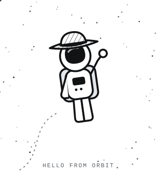

<picture>
  <source media="(prefers-color-scheme: dark)" srcset="assets/banner-dark.svg">
  
</picture>

  <samp>
    <a href="https://yugendhra.me">yugendhra.me</a>
    &nbsp;·&nbsp;
    <a href="https://www.linkedin.com/in/y9ndra">linkedin</a>
    &nbsp;·&nbsp;
    <a href="https://leetcode.com/u/y9ndra">leetcode</a>
    &nbsp;·&nbsp;
    <a href="mailto:yugendhra18@gmail.com">email</a>
  </samp>

 

<table>
  <tr>
    <td width="64%" valign="middle">
      

        I'm Yugendhra, an IT graduate from Chennai. I build backend systems and like
        figuring out how things work under the hood.
      

      
These days I'm building projects and contributing to open source.

    </td>
    <td width="36%" align="center" valign="middle">
      <picture>
        <source media="(prefers-color-scheme: dark)" srcset="assets/astronaut-dark.svg">
        
      </picture>
    </td>
  </tr>
</table>

 

<h3><samp>things I built</samp></h3>

<table>
  <tr>
    <td><a href="https://github.com/y9ndra/sotrix"><b>sotrix</b></a></td>
    <td>Real-time social platform. Socket.IO, BullMQ, Redis, MongoDB, React 19.</td>
    <td align="right"><a href="https://sotrix.yugendhra.me">live</a></td>
  </tr>
  <tr>
    <td><a href="https://github.com/y9ndra/cappd"><b>cappd</b></a></td>
    <td>Reserve-then-reconcile capacity engine for variable-cost workloads. Redis Lua, TypeScript.</td>
    <td align="right"><a href="https://www.npmjs.com/package/cappd">npm</a></td>
  </tr>
  <tr>
    <td><a href="https://github.com/y9ndra/portfolio"><b>portfolio</b></a></td>
    <td>yugendhra.me, built from scratch. Next.js 16, canvas moon banner, Redis views counter.</td>
    <td align="right"><a href="https://yugendhra.me">live</a></td>
  </tr>
  <tr>
    <td><a href="https://github.com/y9ndra/DSA-Grind"><b>DSA-Grind</b></a></td>
    <td>150+ solved problems with notes, mostly C++.</td>
    <td align="right"></td>
  </tr>
</table>

 

<h3><samp>upstream</samp></h3>

  
  <samp><a href="https://github.com/search?q=is%3Apr+author%3Ay9ndra+-user%3Ay9ndra+is%3Amerged&type=pullrequests">→</a></samp>
  &nbsp;&nbsp;&nbsp;
  
  <samp><a href="https://github.com/search?q=is%3Apr+author%3Ay9ndra+-user%3Ay9ndra+is%3Aopen&type=pullrequests">→</a></samp>

 

  <samp>If you don't take risks, you can't create a future.</samp>

  

